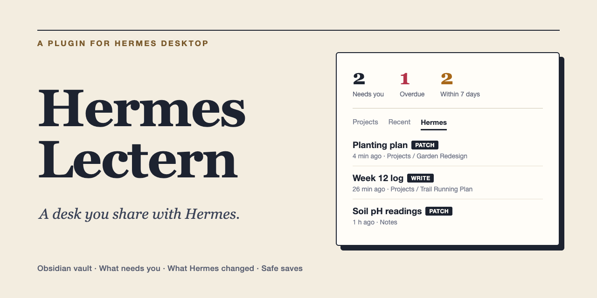
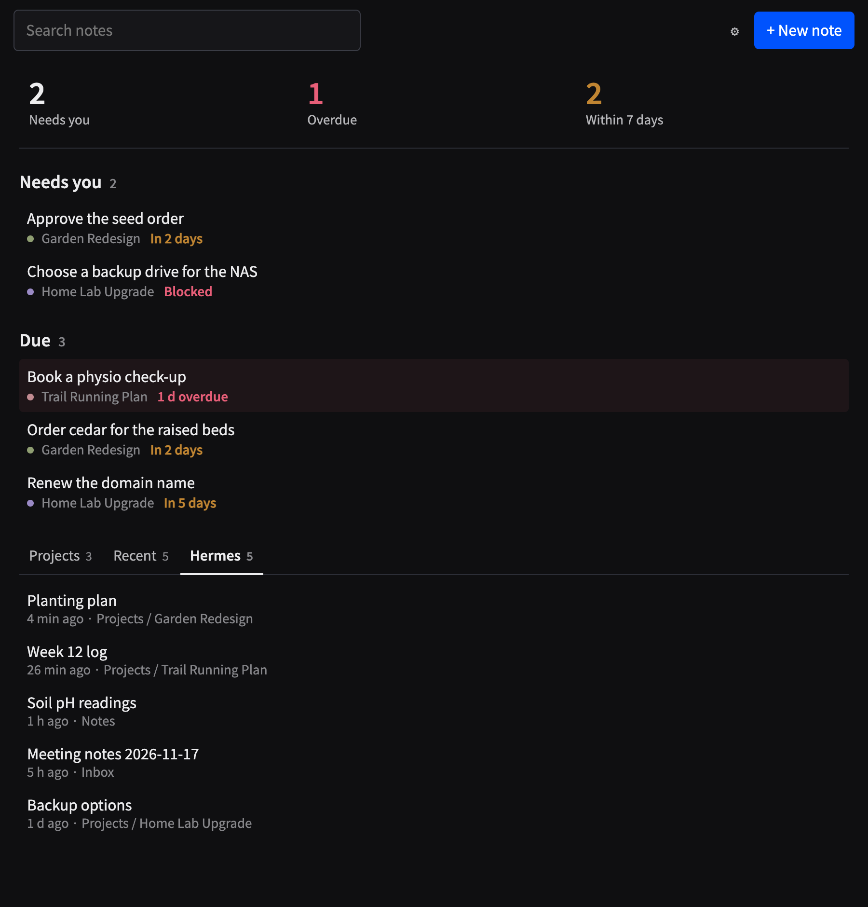
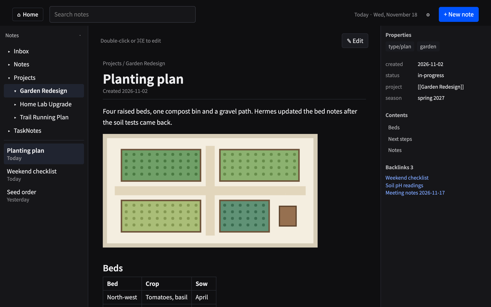
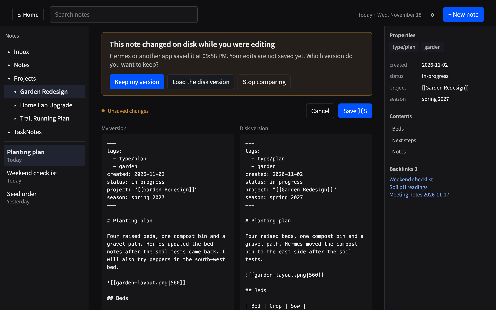

# Hermes Lectern



Read and edit an Obsidian vault inside Hermes Desktop, next to your conversation with Hermes.

Hermes Lectern adds a Lectern page to Desktop. It opens to a dashboard of recent notes, the notes Hermes has changed, and your tasks from task notes or checkboxes. Notes open in a reader with properties, contents and backlinks, and you can edit and save them in place. It is built to sit in half of the Desktop window while you talk to Hermes in the other half.



## What it does

- **Dashboard.** Tabs for recent notes and for notes Hermes changed with its `write_file` and `patch` tools. It also shows overdue tasks, tasks due within 7 days, and tasks in progress grouped by project. Tasks come from two places: task notes in the style of [TaskNotes](https://github.com/callumalpass/tasknotes) (notes with a tag you choose, or in a folder you choose), and checkbox tasks such as `- [ ] Call back 📅 2026-11-20` from the Obsidian Tasks plugin (`📅` due dates) or Dataview (`[due:: 2026-11-20]` fields). To add the tasks that need you, set an attention field (for task notes) or an attention tag (for checkbox tasks).
- **Reader and editor.** Rendered Markdown with wikilinks, image embeds that display, a properties and contents rail, and backlinks. Click Edit, double-click the text or press ⌘E. ⌘S saves, and Esc leaves edit mode when nothing has changed. On Linux, use Ctrl instead of ⌘.
- **Safe saves.** If Hermes or another app changes a note while you are editing it, Hermes Lectern keeps your draft and lets you keep your version, load the disk version or compare them side by side.
  
  
- **Works with the conversation.** Select text in a note and quote it into the chat with the note's full file path. When Hermes writes to a note, the dashboard lists it and an open copy reloads.
- **Open from anywhere.** A vault note opened from elsewhere in Desktop opens in Lectern, on Hermes builds that provide the `preview.fileOpener` area. Older builds ignore this and use the normal file preview.
- **Languages.** English and Japanese UI. The language follows your system unless you pick one in Settings.

## Requirements

- Hermes Agent 0.21.5 or newer, with Hermes Desktop.
- Tested on macOS. Linux should work but is untested. Windows is not supported yet: the vault path must start with `/`.
- An Obsidian vault: a folder that contains `.obsidian/`.

## Install

```sh
hermes plugins install Fiction000/hermes-lectern
hermes plugins enable hermes-lectern
```

Restart Hermes Desktop, open **Lectern** in the sidebar and enter the absolute path of your vault. The first index reads every note: a 5,500-note vault took about 40 seconds on a Mac. Later refreshes only read changed notes; the same vault took under a second when nothing had changed.

## Settings

Open Settings with the gear icon at the top of the Lectern page.

| Setting | What it does | Default |
| --- | --- | --- |
| Vault folder | The vault to read and edit | none |
| Task notes tag | Notes with this tag are tasks, one note per task. Their `status`, `due` and `projects` fields are read. To use a folder instead, set `tasks.notes.folder` in `config.json` | `tasknote` |
| Read checkbox tasks | Reads `- [ ]` lines in every note. `[/]` counts as in progress, and done or cancelled items are skipped. At most 5,000 are kept | on |
| Attention field | A frontmatter field that marks a task note as needing you. A task appears under Needs you when this field is true and its status is `waiting` or `blocked` | off |
| Attention tag | A tag such as `#needs-me` that marks an open checkbox task as needing you | off |
| Inbox folder | Top-level folder where new notes start when you are not browsing a folder | vault root |
| Language | Auto, English or Japanese | Auto |

The top-level `Attachments` folder is left out of the index by default. To change this, edit `exclude` (a list of top-level folder names) in `$HERMES_HOME/hermes-lectern/config.json`.

## What it reads, writes and stores

- **Your vault.** It reads Markdown files in the vault folder you choose and writes only when you save or create a note. It has no delete button. It skips hidden folders and symlinks, so files outside the vault never enter the index. It also reads image files inside the vault to display them, including folders left out of the index.
- **Its own data.** Settings live in `$HERMES_HOME/hermes-lectern/config.json`. The search index is a SQLite file in the same folder, outside your vault, and can be deleted at any time. For a 5,500-note vault it is about 175 MB.
- **Hermes events.** The Desktop side of the plugin listens to Hermes `tool.complete` events for `write_file` and `patch` calls, to notice which notes Hermes wrote. The 50 most recent are kept in Desktop's local storage on your computer. While you edit a note, the plugin also re-reads that one note through Hermes' API every 8 seconds to notice outside changes.
- **Clipboard.** Quoting writes to the clipboard only when the quote cannot be inserted into a chat box.
- **Network and hooks.** It only talks to Hermes' own API. It adds no agent tools or hooks, sends no telemetry and never updates itself. Remote images in notes are not loaded; they show as links.
- **Credentials.** It reads and stores none.

## Development

```sh
node --test tests/
uv run --python 3.14 --with pytest --with fastapi --with httpx pytest -q
```

To benchmark a real vault without writing to it, use a fresh scratch home:

```sh
uv run --python 3.14 --with fastapi --with httpx python scripts/bench_real_vault.py \
  --root "/path/to/vault" --home "/path/to/fresh/hermes-home"
```
