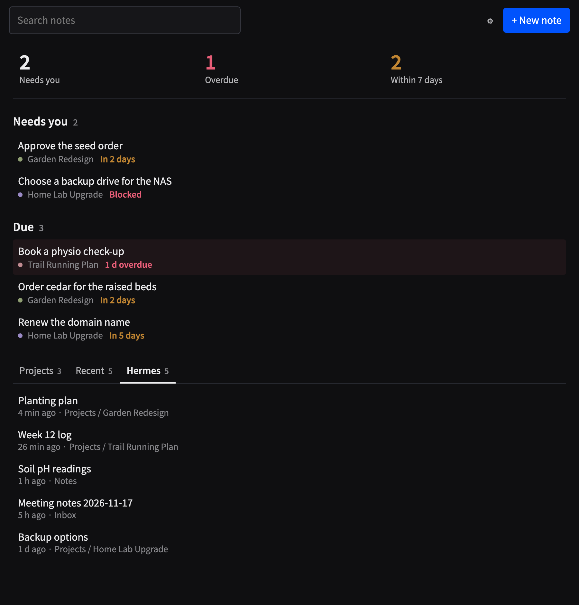
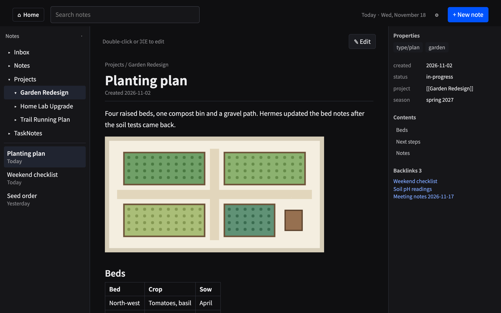
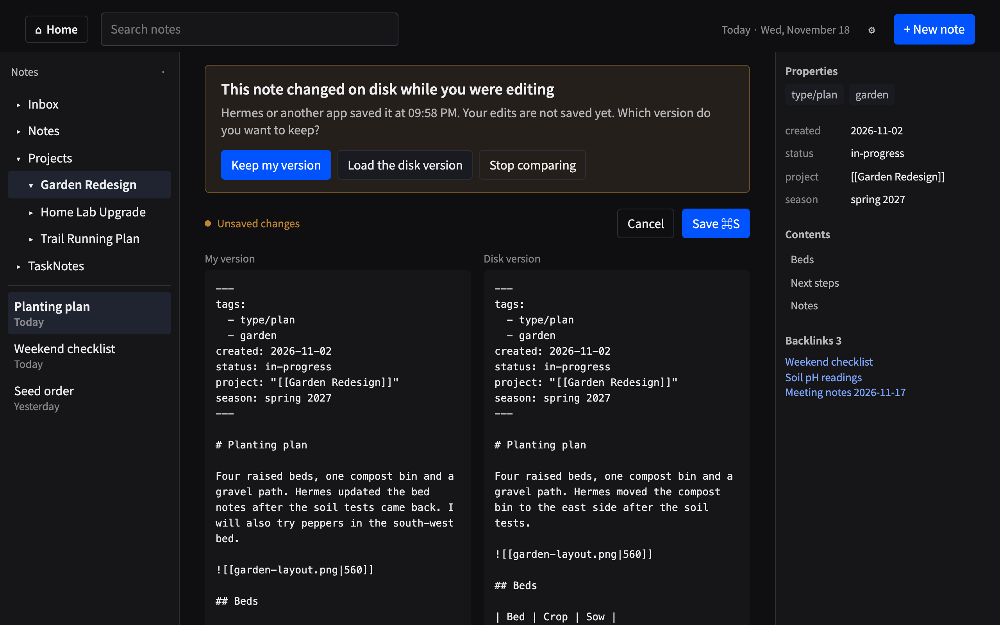

# Add hermes-lectern to the plugin catalog

**Hermes Lectern** is a Hermes Desktop plugin: a desk you share with Hermes. It reads and edits an Obsidian vault next to the conversation, and shows what Hermes just changed and your open tasks, including the ones that need you.

- Repo: https://github.com/Fiction000/hermes-lectern (maintainer: Fiction000, the repository owner)
- Pinned at `<SHA>`, version 0.5.0, MIT licence, `requires_hermes: ">=0.21.5"` (also in `plugin.yaml`)

## What it does

- **Dashboard.** Recent notes, and the notes Hermes changed with `write_file` and `patch`. It also lists overdue tasks, tasks due within 7 days and tasks in progress. Tasks come from task notes (TaskNotes style, by tag or folder) and from checkbox tasks (Obsidian Tasks `📅` dates, Dataview `[due:: ]` fields). Tasks that need you appear once you set an attention field (task notes) or an attention tag (checkboxes).
- **Reader and editor.** Rendered Markdown, wikilinks, vault images, properties, contents and backlinks. Editing is raw Markdown.
- **Open notes follow Hermes.** When Hermes writes to an open note, it reloads.
- **Safe saves.** If the note changes on disk while you edit it, your draft is kept. You can keep it, load the disk version or compare both.

The screenshots use a made-up vault and were rendered from `desktop/plugin.js` on a local test page with a stubbed plugin SDK, not in a Hermes Desktop build. Icons and theme colours differ slightly from Desktop.

## Surfaces used

- Desktop plugin page (`ROUTES_AREA`), a sidebar item (`SIDEBAR_NAV_AREA`), two palette commands (`PALETTE_AREA`), and the `preview.fileOpener` area (ignored by builds without it).
- Dashboard backend API (`dashboard/plugin_api.py`, mounted at `/api/plugins/hermes-lectern`). All vault access happens there; the renderer only calls `ctx.rest`.
- Quoting a selection uses `host.composer.insertText` (the clipboard is the fallback); recent paths use `ctx.storage`.
- No agent tools, hooks or middleware. `capabilities` is empty.

## Disclosure (rule 13)

- **Reads:** Markdown files in the vault folder the user chooses, and image files inside that vault. Hidden folders and symlinks are skipped.
- **Writes:** to the vault only when the user saves or creates a note. No delete.
- **Stores:** settings and a SQLite search index in `$HERMES_HOME/hermes-lectern`, outside the vault. About 175 MB for 5,500 notes; safe to delete.
- **Events:** listens to `tool.complete` for `write_file` and `patch`; keeps the 50 latest paths in Desktop local storage. While a note is being edited, it re-reads that note through the plugin API every 8 seconds.
- **Clipboard:** only when quoting a selection that cannot be inserted into a chat box.
- **Credentials:** none read or stored.
- **Network:** only Hermes' own API. Remote images in notes are not loaded. No telemetry, no self-update, no shell commands, no background process.
- **Platforms:** tested on macOS. Linux untested, Windows unsupported.

## How it differs from other vault plugins

| | Hermes Lectern | Vault View | obsidian-memory |
| --- | --- | --- | --- |
| Focus | Shared desk: needs-you dashboard, notes Hermes changed | Full vault workspace | Vault browser and graph |
| Editing | Raw Markdown | Visual and Markdown, tabs | Raw Markdown |
| Graph | No | Yes | Yes |
| Edit while Hermes writes | Draft kept, compare view, stale saves refused | Draft kept on conflict | Saves overwrite without a revision check (at `1123998`) |
| File access | Plugin's own backend | Desktop shell commands | Plugin backend |
| Agent tools | None | `vault_view_present_note` | None |

Vault View covers more of what a vault app does: visual editing, graph, tabs. Lectern is narrower and is built for working alongside the agent. The table comes from reading each repository's code and README on 2026-11-18 (Vault View at `224c5b5`, obsidian-memory at `1123998`); it is not a full feature audit.

## Testing

Run on the pinned tree, macOS:

- `node --test tests/`: 26 pass
- `uv run --python 3.14 --with pytest --with fastapi --with httpx pytest -q`: 82 passed
- `hermes plugins validate <copy-of-repo>`: exit 0
- Used daily in Hermes Desktop on macOS. The image embeds (0.4.0) and task sources (0.5.0) were checked on the test page and against a real vault through the backend.
- Not tested: Linux.
